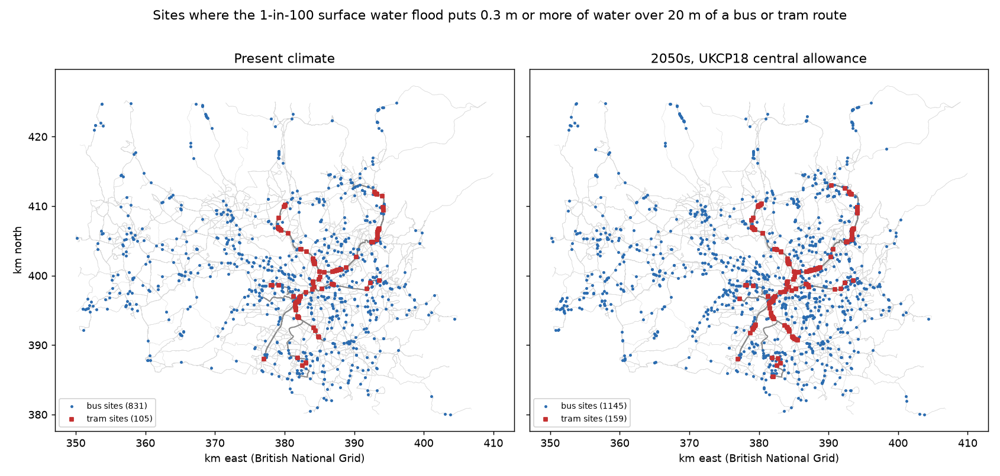
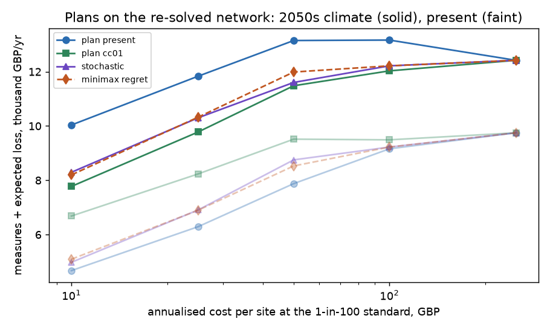

# Floods, heat and adaptation planning for the Greater Manchester bus and tram network (v0.1)

[](https://github.com/serikov-climate-risk/gm-transit-climate-risk/actions/workflows/tests.yml)

Where does surface water flooding cut the Greater Manchester bus and tram network, what does it cost travellers once they reroute or switch mode, which sites should be protected and how should that choice change when the 2050s climate is uncertain? The project builds the morning-peak network from the TfGM timetable feed, estimates a mode choice model on Census journey-to-work flows, overlays the Environment Agency surface water flood maps for today and for the 2050s and chooses adaptation sites with a two-stage stochastic program and a minimax regret program. A second hazard, heat, is valued through the speed restrictions it forces on the Metrolink.

This is a research study on open data. **The losses cover commuting trips only, on one working day per event, valued at an illustrative 12 GBP per generalised hour; the measure costs are illustrative too.** Compare plans and climates with each other; the absolute numbers are a lower bound for the value of a measure, not an appraisal. See [Limits](#limits-of-the-study).

**Main findings**
- **Deep water reaches many routes even in frequent events.** In the 1-in-100 surface water flood, 936 sites put 0.3 m or more of water over at least 20 m of a bus or tram route today (105 of them on the tram), 1,304 in the 2050s (159 on the tram). In the 2050s the 1-in-30 event blocks 55% more route segments than today (2,847 against 1,839).
- **Climate change raises the expected annual loss by about a quarter.** With storm cells of 10 km flooding independently, commuters lose 9.7 thousand GBP a year today and 12.4 thousand in the 2050s (+27%). The frequent floods carry most of it: 1-in-30 events give 58% today and 61% in the 2050s.
- **Site measures reach a limit, and the limit moves with the climate.** Even with every flooded site protected to the present 1-in-1000 standard, 2.1 thousand GBP a year remains today (21%, shallow water that slows traffic everywhere) and 3.3 thousand in the 2050s (27%): a site built for today's 1-in-100 storm floods in the 2050s 1-in-100 storm, and nothing at site level holds the 2050s 1-in-1000 event.
- **The risk is concentrated.** Of 1,310 sites with avoidable loss today, the ten most valuable hold 26% of it and the top 50 hold 64% (20% and 54% in the 2050s). The most valuable single site is worth about 300 GBP a year to commuters, so commuter time alone justifies only cheap measures; freight, other trip purposes and asset damage are outside the model.
- **Planning for one climate is costly when the other one comes.** A plan optimised for today's maps loses 1.7 to 2.3 thousand GBP a year against the best plan if the 2050s climate arrives, and a plan for the 2050s loses 1.6 to 2.0 thousand if it does not (site costs of 10 to 50 GBP per year). The stochastic plan (both climates at 50%) keeps the largest regret at 0.5 to 0.9 thousand and the minimax regret plan at 0.4 to 0.65 thousand, with almost the same expected cost.
- **The two climates call for different sites and standards.** At 25 GBP per site, the plans for today and for the 2050s share 54 of 80 and 89 sites; at 50 GBP, 19 of 48 and 38. Only the 2050s plan uses the higher 1-in-1000 standard (54 sites at 10 GBP).
- **Knowing the climate in advance would be worth 0.4 to 0.6 thousand GBP a year** (expected value of perfect information, site costs of 10 to 50 GBP), 5% to 7% of the expected cost of the stochastic plan.
- **Heat costs more than floods, and the range is wide.** The Metrolink restricts speeds above 30°C. On ERA5 temperatures for 1991-2025, restrictions cost commuters about 10 thousand GBP a year; in 2041-2050 the median of seven high-resolution climate models is 31 thousand (18 to 151 thousand), because one hot day slows the whole tram network while a flood hits one storm cell.



## Method

- **Network** (`gmtransit/network.py`, `graph.py`). TfGM GTFS feed of 11 November 2026, Tuesday 17 November, 07:00 to 09:00. GTFS stops within 120 m are merged into 6,633 stop clusters; 1,003 service patterns (978 bus, 25 Metrolink) with 38,624 ride segments, each with its timetable run time and its GTFS shape. Route-node graph: board edges carry the expected wait (half the headway of the route and direction at that stop, at most 15 minutes, weighted 2) and a boarding penalty of 5 minutes, walking between stops within 500 m (weighted 2), zone connectors to stops inside each MSOA or within 300 m of it. Generalised cost in in-vehicle minutes. Heavy rail is not in the feed.
- **Demand and behaviour** (`gmtransit/demand.py`). 2011 Census journey-to-work flows between the 346 Greater Manchester MSOAs by mode (WU03EW, Nomis); 2011 rather than 2021 because the 2021 Census was taken in a lockdown and its public flow tables do not carry the mode. 68,224 OD pairs and 793,256 commuters by public transport (bus and tram), car, bicycle or on foot. Aggregate multinomial logit estimated by maximum likelihood: one coefficient on generalised time for all modes (-0.0062 per minute, standard error 0.0002), mode constants and log-distance terms; rho-squared 0.43, predicted shares by distance band close to the observed ones. A flood or heat event changes the public transport cost; travellers reroute on the re-solved network or switch mode, and the welfare loss is the change in logsum.
- **Flood hazard** (`gmtransit/hazard.py`). Environment Agency Risk of Flooding from Surface Water (NaFRA2), polygons fetched through the EA WMS and burnt into 5 m rasters, for flooding of any depth and of 0.3 m or more, today and for the EA climate change scenario (UKCP18 central allowance, 2050s, 2040-2060). The High, Medium and Low bands are read as the extents of the 1-in-30, 1-in-100 and 1-in-1000 events. Each ride segment is sampled every 5 m along its shape. Deep water over 20 m or more blocks it: a tram segment is out of service, a bus diverts at an assumed 8 minutes per site. Shallow water slows traffic over the flooded length by the depth-disruption function of Pregnolato et al. (2017) at an assumed 0.1 m. Deep runs are grouped into 100 m sites, the candidates for measures.
- **Events and losses** (`gmtransit/impact.py`). Surface water floods come from convective storms, so the region is split into storm cells of 10 km that flood independently, each at the extent of one return period. Expected annual loss = sum over cells and return-period bins of probability x event loss, with the event on a working day (5/7) and both directions of the commute affected. Costs only rise in an event, so only the origins whose intact path crosses an affected segment are re-solved.
- **Adaptation plans** (`gmtransit/optimize.py`). First stage: which sites get a measure, to the present 1-in-100 standard (cost c per year) or the 1-in-1000 standard (2.5c). In the 2050s an event of return period T is taken to be as intense as a present event of about 3T, so a 1-in-100 measure holds the 2050s 1-in-30 event but not the 2050s 1-in-100 event. Second stage: rerouting and mode change. Each OD pair's avoidable loss in an event is split over its blocking units on the intact path (each flooded bus segment, all flooded tram segments together) and recovered when all sites of a unit are dry; this gives a mixed-integer program over 1,376 sites and 3,586 scenario-unit groups, solved with HiGHS. Plans: optimal for today's climate, for the 2050s, the stochastic plan (50% each) and the minimax regret plan. **Every plan is then evaluated exactly**, by re-solving the network in all 174 events of both climates.
- **Heat** (`gmtransit/heat.py`). TfGM reported to the Greater Manchester Transport Committee (Metrolink Service Performance, 16 September 2022) that the July 2022 heat "significantly impacted overhead line equipment and required temporary speed restrictions and service cancellations", and that speed restrictions were applied in August 2022 with temperatures "exceeding 30°C". Here: above 30°C tram run times rise by an assumed 40%; at 34°C or more (the 18 and 19 July 2022 days) trams also run at half frequency (assumed). Daily maximum temperature at Manchester from ERA5 (Open-Meteo archive); 2041-2050 by quantile delta mapping from seven HighResMIP models (Open-Meteo climate API).

## Results

Network sections blocked by deep water (0.3 m or more over at least 20 m), all of Greater Manchester flooded at once:

| Climate | Event | Blocked segments | of which tram | Sites | Shallow-water share of route length |
|---|---|---:|---:|---:|---:|
| Today | 1-in-30 | 1,839 | 86 | 463 | 5.8% |
| Today | 1-in-100 | 3,720 | 197 | 936 | 13.1% |
| Today | 1-in-1000 | 7,832 | 347 | 2,099 | 28.2% |
| 2050s | 1-in-30 | 2,847 | 177 | 715 | 9.4% |
| 2050s | 1-in-100 | 5,145 | 270 | 1,304 | 19.1% |
| 2050s | 1-in-1000 | 10,247 | 374 | 2,820 | 34.8% |

Expected annual loss of commuters, thousand GBP per year, by the size of the storm cells:

| Storm cells | Today | 2050s | Today, all sites protected | 2050s, all sites protected |
|---|---:|---:|---:|---:|
| 5 km | 11.1 | 14.4 | 2.1 | 3.4 |
| 10 km (central) | 9.7 | 12.4 | 2.1 | 3.3 |
| 20 km | 9.2 | 11.8 | 2.1 | 3.2 |
| Whole region at once | 7.9 | 10.4 | 2.1 | 3.2 |

Smaller cells mean more independent events a year; the region-wide case has the largest single events but the fewest. The loss of an event grows less than its extent: a traveller already cut off at one site loses little more when a second site on the way floods.



Adaptation plans, evaluated on the re-solved network; site cost per year at the 1-in-100 standard. Total = measures + expected annual loss, thousand GBP per year:

| Site cost (GBP/yr) | Plan | Sites (1-in-1000) | Total, today | Total, 2050s | Largest regret |
|---|---|---|---:|---:|---:|
| 10 | for today | 154 (0) | 4.68 | 10.04 | 2.26 |
| 10 | for the 2050s | 153 (54) | 6.68 | 7.77 | 2.01 |
| 10 | stochastic | 163 (7) | 4.98 | 8.30 | 0.52 |
| 10 | minimax regret | 160 (15) | 5.09 | 8.20 | 0.43 |
| 25 | for today | 80 (0) | 6.29 | 11.83 | 2.06 |
| 25 | for the 2050s | 89 (3) | 8.23 | 9.78 | 1.94 |
| 25 | stochastic | 101 (0) | 6.91 | 10.30 | 0.62 |
| 25 | minimax regret | 101 (0) | 6.90 | 10.32 | 0.61 |
| 50 | for today | 48 (0) | 7.88 | 13.15 | 1.67 |
| 50 | for the 2050s | 38 (0) | 9.52 | 11.48 | 1.64 |
| 50 | stochastic | 35 (0) | 8.75 | 11.60 | 0.88 |
| 50 | minimax regret | 30 (0) | 8.53 | 11.99 | 0.65 |
| 100 | for today | 12 (0) | 9.16 | 13.16 | 1.13 |
| 100 | for the 2050s | 7 (0) | 9.49 | 12.03 | 0.33 |
| 100 | stochastic | 5 (0) | 9.23 | 12.22 | 0.19 |

At 250 GBP per site no site is worth protecting for commuters alone (9.75 and 12.42 thousand GBP without measures). Expected value of perfect information on the climate: 0.41, 0.57, 0.50 and 0.13 thousand GBP per year at site costs of 10, 25, 50 and 100.

Heat, expected annual loss from Metrolink restrictions (thousand GBP per year; one restriction day costs commuters 68 thousand GBP, a day with half frequency as well 110 thousand):

| Thresholds | ERA5 1991-2025 | 2041-2050, median of 7 models | Range |
|---|---:|---:|---:|
| 30°C / 34°C | 10 | 31 | 18 to 151 |
| 29°C / 33°C | 21 | 59 | 36 to 220 |

ERA5 smooths the urban maximum (30.1°C on the hottest day of the August 2022 spell), hence the lower thresholds as a check. Restriction days rise from 0.17 a year to between 0.35 and 3.0 a year across the models (30°C threshold).

Files: `results/flooded_network.csv`, `results/events_*.csv` (every event), `results/plans.csv`, `results/plan_sites.csv` (the sites of each plan), `results/mode_choice.csv`, `results/heat.csv`.

## Data

- Timetables: TfGM GTFS feed (bus and Metrolink), Open Database Licence; contains Transport for Greater Manchester data.
- Flood maps: Environment Agency, Risk of Flooding from Surface Water (NaFRA2) and its climate change scenario, WMS, Open Government Licence; © Environment Agency copyright and/or database right.
- Demand: 2011 Census WU03EW through the Nomis API; MSOA 2011 boundaries from the ONS. Office for National Statistics, Open Government Licence; contains OS data © Crown copyright and database right.
- Temperatures: Open-Meteo historical weather (ERA5, Copernicus Climate Change Service) and climate change API (HighResMIP models), CC BY 4.0.
- Pregnolato, M., Ford, A., Wilkinson, S. M. and Dawson, R. J. (2017). The impact of flooding on road transport: a depth-disruption function. Transportation Research Part D, 55, 67-81.

## Limits of the study

- Commuters only, from the 2011 Census; Metrolink has grown since, and other trip purposes, freight and asset damage are not counted, so the losses and the value of each site are a lower bound.
- The flood bands are read as the extents of single events; real storms flood part of a band, which the storm cells approximate. Depths below 0.3 m are not resolved, and the shallow-water slowdown assumes 0.1 m.
- Bus diversions are a fixed 8 minutes per site, since the road network is not modelled; cars are not slowed by floods, so switching to the car is too easy in an event.
- One event lasts one working day. Frequency-based assignment with fixed headways and no crowding or capacity limits.
- The 2050s map is one scenario (UKCP18 central allowance); the equivalence of a 2050s event with a present event of three times the return period is an assumption. The two climates get equal weights.
- The split of each pair's loss over its blocking units is an approximation; the exact re-evaluation of each plan corrects the costs but not the choice of sites.
- Heat effects (40% slower, half frequency) are assumptions on top of the TfGM report; buses are taken to be unaffected.

## Run

`pip install -e ".[test]"`, `pytest`, then

```
python scripts/download_inputs.py       # GTFS, MSOA boundaries, temperatures
python scripts/download_census_od.py
python scripts/build_network.py         # also lists the 5 km flood tiles the network crosses
python scripts/download_flood_tiles.py --tiles data/raw/needed_tiles.txt   # 2 to 4 hours, EA server
python scripts/run_analysis.py                    # about 1 hour on 8 cores
python scripts/run_analysis.py --stage ab --cell-km 5    # and 20, and --region-wide
python scripts/run_heat.py
python scripts/make_figures.py
```

Raw data stay in `data/raw` (not in the repository); results and figures are in `results`.
